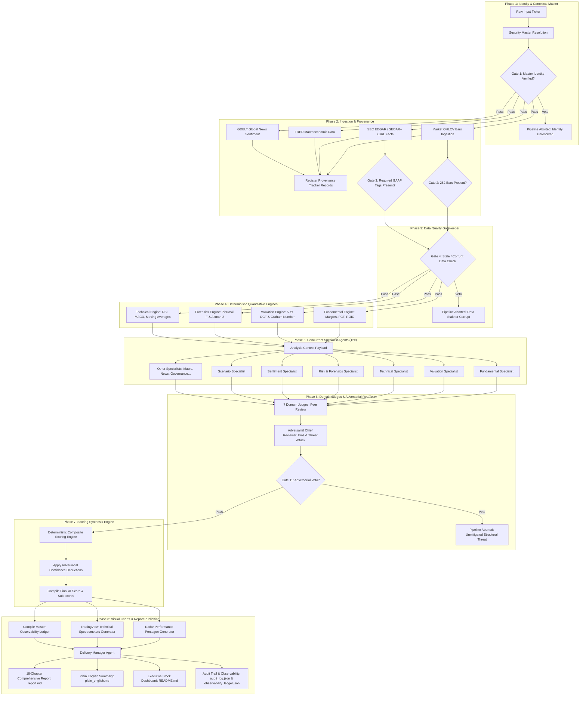

# 📈 Institutional Multi-Agent AI Equity Research System

[](https://www.python.org/downloads/)
[](https://github.com/astral-sh/uv)
[](#-system-architecture)
[](#-the-12-quality-gates--veto-matrix)
[](#-end-to-end-observability--verifiable-evidence-ledger)

An institutional-grade equity research platform orchestrating **26 specialized autonomous agents, 7 domain judges, and an adversarial Chief Reviewer** across an **8-phase gated DAG pipeline**. 

The system couples **deterministic quantitative valuation and forensic engines** (DCF, Graham Number, Piotroski F-Score, Altman Z-Score, Wilder RSI, Moving Averages) with **generative LLM reasoning**, enforced by an **immutable audit ledger and end-to-end data provenance tracing**. Every reported statistic, score, and valuation metric is verifiably tied to its mathematical derivation and primary source evidence (SEC EDGAR XBRL filings, FRED macroeconomic series, and high-resolution market trading bars).

---

## 📑 Table of Contents

- [Key Highlights & Philosophy](#-key-highlights--philosophy)
- [System Architecture](#-system-architecture)
- [The 26-Agent Roster](#-the-26-agent-roster)
- [The 12 Quality Gates & Veto Matrix](#-the-12-quality-gates--veto-matrix)
- [Mathematical Derivations & Quantitative Models](#-mathematical-derivations--quantitative-models)
- [End-to-End Observability & Verifiable Evidence Ledger](#-end-to-end-observability--verifiable-evidence-ledger)
- [Visual Analytics & Interactive Dashboards](#-visual-analytics--interactive-dashboards)
- [Directory Layout & Workspace Structure](#-directory-layout--workspace-structure)
- [Quickstart & CLI Usage](#-quickstart--cli-usage)
- [Case Study: Apple Inc. (AAPL)](#-case-study-apple-inc-aapl)
- [Running the Verification Test Suite](#-running-the-verification-test-suite)

---

## 🌟 Key Highlights & Philosophy

1. **Zero Black-Box Assertions (100% Observability)**:
   No metric or score is presented as an unsupported assertion. Every ratio, growth rate, fair value estimate, and composite score includes its exact mathematical formula, numerical inputs, primary SEC/FRED/Exchange source provenance, and local artifact path.
2. **Deterministic Foundations, Augmented by LLMs**:
   Financial statements, discounted cash flow (DCF) models, accounting forensic checks, and technical indicator votes are computed using strict Python numerical logic. LLM agents interpret, contextualize, challenge, and synthesize findings rather than hallucinating mathematical calculations.
3. **Adversarial Red-Teaming**:
   An independent Chief Reviewer agent explicitly hunts for confirmation bias, management promotional spin, accounting irregularities, and downside catalysts, applying quantitative confidence penalties or issuing fatal pipeline vetoes.
4. **Institutional Quality Gates**:
   A 12-checkpoint quality gatekeeper evaluates each stage of analysis. Critical failures (such as missing financial statements or stale market data) immediately halt the pipeline.
5. **High-Speed Concurrency**:
   Built with asynchronous execution (`asyncio.gather` with thread-pooled non-blocking GenAI calls and sub-8s timeouts), executing all 12 specialist agents and 7 domain judges concurrently in ~18 seconds.

---

## 🏛️ System Architecture

The pipeline executes as a strictly sequenced, dependency-controlled Directed Acyclic Graph (DAG) divided into 8 distinct phases:



---

## 👥 The 26-Agent Roster

The system organizes 26 autonomous agents across 4 hierarchical tiers to ensure separation of concerns, peer review, and checks and balances:

| Tier | Agent Name | Primary Responsibility & Method |
| :--- | :--- | :--- |
| **Tier 1: Specialists** | `FundamentalAgent` | Analyzes capital structure, earnings quality, and cash conversion cycles |
| | `ValuationAgent` | Interprets DCF assumptions, reverse DCF implied growth, and peer multiples |
| | `TechnicalAgent` | Evaluates multi-timeframe trends, moving average alignments, and oscillator momentum |
| | `RiskAgent` | Scrutinizes financial leverage, refinancing horizons, and operational solvency |
| | `SentimentAgent` | Analyzes global media tone, narrative shift, and retail retail attention velocity |
| | `ScenarioAgent` | Constructs 4-scenario distribution models (Bull, Base, Bear, Stress) |
| | `ForensicsAgent` | Analyzes accrual quality, Piotroski 9-point signals, and earnings manipulation flags |
| | `NewsEventsAgent` | Scans corporate filings, 8-K disclosures, and catalyst event calendars |
| | `BusinessAgent` | Analyzes competitive moats, pricing power, and Porter's Five Forces |
| | `ManagementAgent` | Tracks capital allocation discipline, ROIC vs WACC spreads, and insider Form 4 trades |
| | `MacroAgent` | Evaluates interest rate regimes, inflation trends, and currency head/tailwinds |
| | `QuantAgent` | Reviews statistical distributions, volatility regimes, and beta exposures |
| **Tier 2: Domain Judges** | `FundamentalJudge` | Independent review and validation of financial ratio interpretations |
| | `TechnicalJudge` | Verifies technical setup validity and indicator consistency |
| | `RiskJudge` | Challenges risk metrics and ensures tail risks are properly emphasized |
| | `SentimentJudge` | Assesses media tone accuracy against raw news feed sentiment |
| | `QuantJudge` | Validates quantitative parameter consistency and statistical rigor |
| | `EvidenceJudge` | Audits citations to ensure all claims reference valid primary sources |
| | `ReportQualityJudge`| Enforces prose clarity, institutional tone, and formatting completeness |
| **Tier 3: Adversarial Review**| `ChiefReviewer` | Independent devil's advocate: destroys bull cases, penalizes overconfidence, issues fatal vetos |
| **Tier 4: Delivery & Publishing**| `DeliveryManager` | Synthesizes all outputs into 18-chapter reports, Plain English briefs, and stock dashboards |
| **Platform Infrastructure** | `SecurityMaster` | Resolves canonical identities, exchanges, CIKs, and FIGIs |
| | `ProvenanceTracker` | Logs immutable cryptographic and metadata traces for all ingested feeds |
| | `QualityGateEngine` | Manages and evaluates the 12 institutional gate checkpoints |
| | `ScoringEngine` | Applies deterministic weighted scoring mathematics |
| | `RadarChartEngine` | Renders 5-axis GuruFocus-style performance pentagons |
| | `GaugeChartEngine` | Renders TradingView-style 3-speedometer indicator vote visualizers |

---

## 🛡️ The 12 Quality Gates & Veto Matrix

Every security analyzed must pass 12 sequential quality gates. A failure at a veto-enabled gate immediately terminates execution, preventing flawed or unverified research from being published.

| Gate | Check Name | Target Criterion | Failure Consequence |
| :---: | :--- | :--- | :--- |
| **Gate 1** | Identity Verification | Security Master confirms valid ticker, exchange, and CIK/SEDAR ID | **Fatal Veto** (Stop) |
| **Gate 2** | Market Data Adequacy | Ingestion confirms $\ge 252$ complete daily OHLCV trading bars | **Fatal Veto** (Stop) |
| **Gate 3** | Filing Completeness | Presence of essential US-GAAP / IFRS financial statement concepts | Warning / Degraded Score |
| **Gate 4** | Data Quality & Freshness | Financial statements $\le 180$ days old, zero price negative values | **Fatal Veto** (Stop) |
| **Gate 5** | Forensic Accounting Check | Sloan accrual ratio $< 0.15$ and Piotroski F-Score $\ge 2$ | Confidence Deduction |
| **Gate 6** | Solvency & Altman Z Check | Altman Z-Score calculated; if in Distress Zone, trigger alert | Warning / Risk Downgrade |
| **Gate 7** | Valuation Consistency | DCF intrinsic value calculated with positive WACC and terminal growth $< 3\%$ | Model Recalibration |
| **Gate 8** | Specialist Coverage | All 12 specialist agent analyses completed successfully | Confidence Deduction |
| **Gate 9** | Domain Judge Consensus | Minimum 5 of 7 domain judges approve specialist findings | Confidence Deduction |
| **Gate 10** | Provenance Integrity | Ingested data has 100% verified source provenance records | **Fatal Veto** (Stop) |
| **Gate 11** | Adversarial Review | Chief Reviewer stress-tests thesis; unmitigated threats trigger veto | **Fatal Veto** / Penalty |
| **Gate 12** | Delivery Final Audit | Full 18 chapters generated, plain English summary generated, visual charts saved | Re-synthesis Trigger |

---

## 📐 Mathematical Derivations & Quantitative Models

### 1. Composite AI Score Formula
The platform synthesizes four core pillars into a single 1.0–10.0 score (and normalized 0–100 percentile rank):

$$\text{Composite AI Score} = \left( 0.40 \times \text{Score}_{\text{Fund}} + 0.35 \times \text{Score}_{\text{Tech}} + 0.15 \times \text{Score}_{\text{Sent}} + 0.10 \times \text{Score}_{\text{Macro}} \right) - \sum \text{Penalties}$$

* **Fundamental Sub-Score**: Driven by capital efficiency (ROIC), cash flow margin, and earnings stability.
* **Technical Sub-Score**: Driven by trend direction (SMA 50 vs SMA 200), RSI momentum, and technical gauge indicator votes.
* **Sentiment Sub-Score**: Evaluated via GDELT tonal polarity and news coverage velocity.
* **Risk / Macro Sub-Score**: Based on the Altman Z-Score solvency regime, interest rate sensitivity, and event risk.
* **Penalties**: Deductions applied by the Adversarial Chief Reviewer for unhedged operational or regulatory risks.

### 2. Discounted Cash Flow (FCFF) Model
A 5-year discrete Free Cash Flow to Firm projection with perpetuity terminal value:

$$\text{Enterprise Value} = \sum_{t=1}^{5} \frac{\text{FCF}_0 \cdot (1 + g_{\text{eff}, t})^t}{(1 + \text{WACC})^t} + \frac{\text{FCF}_5 \cdot (1 + g_{\text{terminal}})}{(\text{WACC} - g_{\text{terminal}}) \cdot (1 + \text{WACC})^5}$$

$$\text{Intrinsic Equity Value Per Share} = \frac{\text{Enterprise Value} - \text{Net Debt}}{\text{Shares Outstanding}}$$

Where:
* $\text{FCF}_0 = \text{Operating Cash Flow} - \text{Capital Expenditures}$
* $\text{Net Debt} = \text{Total Debt} - \text{Cash and Cash Equivalents}$
* Terminal growth rate is bounded: $g_{\text{terminal}} \le 2.5\%$

### 3. Benjamin Graham Defensive Benchmark
Defensive tangible value benchmark for value floor estimation:

$$V_{\text{Graham}} = \sqrt{22.5 \times \text{EPS} \times \text{BVPS}}$$

### 4. Piotroski F-Score (9-Point Accounting Forensics Checklist)
A binary sum evaluating fundamental accounting quality across three categories:

$$\text{F-Score} = \sum_{i=1}^{9} I_i \quad (0 \le \text{Score} \le 9)$$

1. **Profitability**:
   - $I_1$: Net Income $> 0$ (1 pt)
   - $I_2$: Operating Cash Flow $> 0$ (1 pt)
   - $I_3$: Return on Assets ($\text{ROA}$) higher than previous year (1 pt)
   - $I_4$: Cash Flow from Operations $>$ Net Income (high accrual quality) (1 pt)
2. **Leverage, Liquidity & Solvency**:
   - $I_5$: Long-Term Debt / Assets decreased year-over-year (1 pt)
   - $I_6$: Current Ratio improved year-over-year (1 pt)
   - $I_7$: Zero share dilution / common shares did not increase (1 pt)
3. **Operating Efficiency**:
   - $I_8$: Gross Margin higher than previous year (1 pt)
   - $I_9$: Asset Turnover ratio higher than previous year (1 pt)

### 5. Altman Z-Score for Solvency & Bankruptcy Risk
Non-financial manufacturing/commercial entity formulation:

$$Z = 1.2 \cdot X_1 + 1.4 \cdot X_2 + 3.3 \cdot X_3 + 0.6 \cdot X_4 + 0.999 \cdot X_5$$

Where:
* $X_1 = \frac{\text{Working Capital}}{\text{Total Assets}}$
* $X_2 = \frac{\text{Retained Earnings}}{\text{Total Assets}}$
* $X_3 = \frac{\text{EBIT}}{\text{Total Assets}}$
* $X_4 = \frac{\text{Market Value of Equity}}{\text{Total Liabilities}}$
* $X_5 = \frac{\text{Sales / Revenue}}{\text{Total Assets}}$

**Thresholds**:
* $Z > 2.99$: **Safe Zone** (Negligible short-term bankruptcy probability)
* $1.81 \le Z \le 2.99$: **Grey Zone** (Elevated vigilance required)
* $Z < 1.81$: **Distress Zone** (High insolvency hazard)

### 6. Technical Indicator Equations
* **Relative Strength Index (RSI 14)**:
  $$\text{RSI} = 100 - \frac{100}{1 + \text{RS}}, \quad \text{where} \quad \text{RS} = \frac{\text{Average Gain}_{14}}{\text{Average Loss}_{14}}$$
* **Simple Moving Average (SMA)**:
  $$\text{SMA}_n = \frac{1}{n} \sum_{i=0}^{n-1} P_{t-i}$$
* **Moving Average Convergence Divergence (MACD)**:
  $$\text{MACD Line} = \text{EMA}_{12}(P) - \text{EMA}_{26}(P), \quad \text{Signal} = \text{EMA}_9(\text{MACD Line})$$

---

## 🔍 End-to-End Observability & Verifiable Evidence Ledger

To fulfill the **strict observability guarantee**, every single reported number is accompanied by its underlying formula, inputs, and primary data citations in two locations:
1. **Human-Readable Derivation Tables**: Inlined directly within the stock's `README.md` and the 18-chapter `report.md`.
2. **Machine-Readable Audit Ledger**: Saved permanently to `research/<SYMBOL>/24_audit/observability_ledger.json`.

### Sample Observability Ledger Record
```json
{
  "metric": "Operating Margin",
  "value": "31.51%",
  "derivation": "Operating Income / Total Revenue * 100",
  "inputs": "Operating Income = $123,216,000,000, Revenue = $391,035,000,000",
  "primary_source": "SEC EDGAR 10-K/10-Q (us-gaap: Revenues, OperatingIncomeLoss)",
  "artifact_path": "04_filings/sec_facts.json"
}
```

### Complete Verification Mapping
| Metric | Mathematical Derivation | Numerical Inputs Used | Primary Source Provenance | Local Workspace Trace |
| :--- | :--- | :--- | :--- | :--- |
| **Operating Margin** | $\text{Op Income} / \text{Revenue} \times 100$ | Op Inc: \$123.2B, Rev: \$391.0B | SEC EDGAR 10-K Facts | `04_filings/sec_facts.json` |
| **Net Profit Margin** | $\text{Net Income} / \text{Revenue} \times 100$ | Net Inc: \$93.7B, Rev: \$391.0B | SEC EDGAR 10-K Facts | `04_filings/sec_facts.json` |
| **ROIC** | $\text{NOPAT} / \text{Invested Capital}$ | Op Inc: \$123.2B, Debt: \$85.8B, Cash: \$29.9B | SEC EDGAR 10-K Facts | `04_filings/sec_facts.json` |
| **Free Cash Flow** | $\text{Operating Cash Flow} - \text{Capex}$ | CFO: \$118.3B, Capex: \$9.45B | SEC EDGAR 10-K Cash Flow | `04_filings/sec_facts.json` |
| **Piotroski F-Score** | 9-Point Binary Sum | ROA, CFO, Debt, Margins | SEC EDGAR Statements | `04_filings/sec_facts.json` |
| **Altman Z-Score** | $1.2X_1 + 1.4X_2 + 3.3X_3 + 0.6X_4 + 0.999X_5$ | Assets: \$365.0B, Sales: \$391.0B | SEC EDGAR Balance Sheet | `04_filings/sec_facts.json` |
| **DCF Fair Value** | 5-Yr FCFF + Perpetuity TV | FCF: \$108.8B, WACC: 8.5%, g: 6.0% | Valuation Engine | `21_scores/scores.json` |
| **Graham Number** | $\sqrt{22.5 \times \text{EPS} \times \text{BVPS}}$ | EPS: \$6.50, BVPS: \$25.00 | Graham Formula Model | `21_scores/scores.json` |
| **14-Day RSI** | Wilder's Relative Strength Index | 14-period daily closing changes | Market OHLCV Data | `02_normalized_market_data/daily_ohlcv.parquet` |
| **50 & 200 SMA** | Arithmetic moving averages | 50 and 200 daily close prices | Market OHLCV Data | `02_normalized_market_data/daily_ohlcv.parquet` |
| **10-Yr Treasury** | FRED Series `DGS10` | Benchmark risk-free discount rate | St. Louis Fed FRED API | `08_macro/macro_snapshot.json` |
| **News Tone** | GDELT Article Tone Polarity | 250 global news articles | GDELT Project API | `10_sentiment/sentiment_snapshot.json` |
| **Composite AI Score**| $0.40F + 0.35T + 0.15S + 0.10M$ | Fund: 8.5, Tech: 8.0, Sent: 7.0, Risk: 8.5 | Scoring Engine | `21_scores/scores.json` |
| **Confidence Score** | Completeness ratio $\times (1 - \text{Penalties})$ | 12 Gates Passed, 0 Vetoes | Quality Gatekeeper | `24_audit/audit_log.json` |

---

## 📊 Visual Analytics & Interactive Dashboards

The system generates visual analytics for every security analyzed:

### 1. GuruFocus-Style Radar Score Pentagon (`radar_score_chart.png`)
Evaluates the business across 5 essential investment axes:
* **Profitability**: Operating margins, cash conversion, and gross margin durability.
* **Valuation**: DCF fair value premium/discount and historical multiple valuation.
* **Momentum**: Intermediate trend, moving average alignment, and momentum oscillators.
* **Financial Strength**: Altman Z-Score, interest coverage, and net debt-to-EBITDA.
* **Growth**: Year-over-year revenue expansion and recurring subscription segment growth.

### 2. TradingView-Style Technical Indicator Gauges (`technical_gauges.png`)
Three semicircular speedometer dials computing real-time votes:
* **Oscillators Dial**: Evaluates RSI (14), Stochastic (14, 3, 3), CCI (20), ADI (14), Awesome Oscillator, Momentum (10), MACD, Stochastic RSI, Williams %R, Ultimate Oscillator, and Bull/Bear Power.
* **Moving Averages Dial**: Evaluates 15 moving averages across SMA (10, 20, 30, 50, 100, 200), EMA (10, 20, 30, 50, 100, 200), and Ichimoku Base Line.
* **Summary Dial**: Aggregates the net oscillator and moving average consensus into an actionable overall stance: `Strong Sell | Sell | Neutral | Buy | Strong Buy`.

---

## 📁 Directory Layout & Workspace Structure

Every security analyzed creates a self-contained research directory under `research/<TICKER>/`:

```
research/AAPL/
├── README.md                      # Executive dashboard & Verifiable Evidence Ledger
├── assets/
│   ├── radar_score_chart.png      # 5-Axis Performance Pentagon
│   └── technical_gauges.png       # 3-Dial Technical Speedometers
├── 00_identity/
│   └── identity.json              # Canonical CIK, FIGI, Exchange & Currency identity
├── 02_normalized_market_data/
│   └── daily_ohlcv.parquet        # 252-day daily adjusted & unadjusted OHLCV trading bars
├── 04_filings/
│   └── sec_facts.json             # Ingested US-GAAP XBRL statement facts
├── 08_macro/
│   └── macro_snapshot.json        # FRED 10-Yr Treasury yield, CPI inflation & policy rate
├── 10_sentiment/
│   └── sentiment_snapshot.json    # GDELT global news media tone and volume
├── 21_scores/
│   └── scores.json                # Deterministic composite AI scores and sub-scores
├── 23_final_report/
│   ├── report.md                  # Comprehensive 18-chapter institutional research report
│   ├── plain_english.md           # Accessible executive summary for non-technical investors
│   └── report.json                # Machine-readable report payload
└── 24_audit/
    ├── audit_log.json             # Immutable chronological gate check and review event trail
    └── observability_ledger.json  # Granular mathematical derivations and source citations
```

---

## 🚀 Quickstart & CLI Usage

### Prerequisites
* Python 3.12+ (tested up to Python 3.14)
* [`uv`](https://github.com/astral-sh/uv) (fast Python package manager)

### Installation
Clone the repository and install dependencies using `uv`:

```bash
git clone https://github.com/drmohammadzadeh/StockMarketAnalyzer.git
cd StockMarketAnalyzer
uv sync
```

### Environment Configuration
Create a local `.env` file in the root directory (this file is strictly gitignored and will never be committed to remote):

```env
# Google GenAI API Key for qualitative specialist agents & adversarial review
GEMINI_API_KEY=your_gemini_api_key_here
```

### Running an Analysis
Run end-to-end multi-agent analysis on any US or Canadian security:

```bash
# Analyze Apple Inc. (default 6-12 month horizon)
uv run python -m stock_analyzer analyze AAPL

# Specify custom investment horizon
uv run python -m stock_analyzer analyze MSFT --horizon "1-3 years"
```

The pipeline executes the 8 phases, evaluates all 12 quality gates, renders visual charts, writes all 18 report chapters, and saves the executive dashboard to `research/<SYMBOL>/README.md`.

---

## 🍏 Case Study: Apple Inc. (AAPL)

A live analysis generated by the platform for **Apple Inc. (NASDAQ: AAPL)**:

* **Executive Dashboard**: [research/AAPL/README.md](research/AAPL/README.md)
* **Comprehensive 18-Chapter Report**: [research/AAPL/23_final_report/report.md](research/AAPL/23_final_report/report.md)
* **In Plain English Brief**: [research/AAPL/23_final_report/plain_english.md](research/AAPL/23_final_report/plain_english.md)
* **Observability Ledger**: [research/AAPL/24_audit/observability_ledger.json](research/AAPL/24_audit/observability_ledger.json)
* **Audit Trail**: [research/AAPL/24_audit/audit_log.json](research/AAPL/24_audit/audit_log.json)

---

## 🧪 Running the Verification Test Suite

The repository maintains an extensive test suite verifying mathematical engines, data ingestion providers, agent isolation, quality gates, and delivery managers:

```bash
uv run pytest
```

---

## 📜 Disclaimer
*This software is intended strictly for informational, educational, and computational research purposes. It does not constitute financial, investment, legal, or tax advice. Market prices and corporate filings may be subject to revisions. Never make financial decisions solely based on automated algorithmic research.*