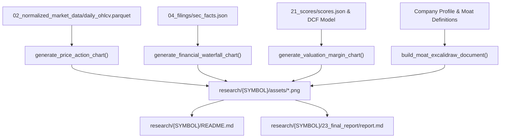

# Comprehensive Visual Charts & Excalidraw Architecture Design

- **Date**: 2026-10-11
- **Status**: Approved
- **Scope**: Multi-Agent Institutional Equity Research Visual Suite

---

## 1. Objective & Requirements

Enhance the equity research reports and root dashboards by adding a comprehensive suite of high-impact visual charts and diagrams. This enables institutional analysts and retail investors to instantly assess a security's price trend, financial health, valuation margin of safety, and business moat at a single glance.

### Success Criteria
1. Add 4 new visual assets alongside existing radar and gauge charts:
   - `price_action_trend.png`: 252-day price action, 50 & 200 SMA trend ribbon, volume histogram, 14-day RSI sub-panel.
   - `financial_conversion_bars.png`: Revenue, Operating Income, Net Income, Operating Cash Flow, and Free Cash Flow ($FCF$) with conversion efficiency annotations.
   - `valuation_margin_gauge.png`: Horizontal valuation target band comparing market price to DCF Fair Value, Graham Number, and 52-week trading bounds.
   - `business_moat_diagram.png` and `business_moat_diagram.excalidraw`: Strategic business model, ecosystem flywheel moat, and risk vector architectural diagram.
2. Embed the visual assets into `research/{SYMBOL}/README.md` (Executive Visual Gallery) and contextually across `report.md` chapters.
3. 100% deterministic, offline-capable local generation.
4. Comprehensive unit and pipeline test coverage with zero regressions.

---

## 2. Component Architecture

### 2.1 `stock_analyzer/engine/charts.py`
Expanded with 3 new Matplotlib-based rendering functions:
1. **`generate_price_action_chart(df: pd.DataFrame, symbol: str, company_name: str, output_path: Path) -> Path`**:
   - Calculates 50-day and 200-day simple moving averages.
   - Computes 14-day RSI momentum indicator.
   - Top panel: Price line with SMA 50 (blue), SMA 200 (orange), shaded fill between SMAs (green for golden cross, red for death cross), and volume bars at bottom.
   - Bottom panel: RSI 14 with 70 overbought and 30 oversold bands.
2. **`generate_financial_waterfall_chart(financials: Dict[str, float], symbol: str, company_name: str, output_path: Path) -> Path`**:
   - Compares: Revenue, Operating Income (EBIT), Net Income, Operating Cash Flow (CFO), Free Cash Flow (FCF).
   - Annotates operating margin %, net margin %, and FCF conversion % ($FCF / \text{Net Income}$).
3. **`generate_valuation_margin_chart(valuation_data: Dict[str, float], symbol: str, company_name: str, output_path: Path) -> Path`**:
   - Horizontal target range showing Deep Value zone, Fair Value zone, and Premium/Overheated zone.
   - Displays Current Price needle marker, DCF Intrinsic Fair Value point, Graham Number floor, and 52-week high/low bracket.
   - Margin of Safety percentage banner.

### 2.2 `stock_analyzer/engine/excalidraw_generator.py` (New Module)
1. **`build_moat_excalidraw_document(symbol: str, company_name: str, profile: Dict[str, Any]) -> Dict[str, Any]`**:
   - Generates valid Excalidraw v2 JSON schema following container discipline and semantic color palette.
   - Structures core business pillars, ecosystem lock-in arrows, and regulatory/competitive risk shields.
2. **`render_moat_diagram(symbol: str, company_name: str, profile: Dict[str, Any], output_base_path: Path) -> Tuple[Path, Path]`**:
   - Writes `business_moat_diagram.excalidraw`.
   - Renders high-resolution vector `business_moat_diagram.png` for direct markdown embedding.

### 2.3 `stock_analyzer/pipeline/orchestrator.py`
In Phase 7 (Post-Evaluation & Reporting), orchestrator renders all 6 visual assets:
- `assets/radar_score_chart.png`
- `assets/technical_gauges.png`
- `assets/price_action_trend.png`
- `assets/financial_conversion_bars.png`
- `assets/valuation_margin_gauge.png`
- `assets/business_moat_diagram.png` (+ `.excalidraw`)

### 2.4 `stock_analyzer/agents/delivery_manager.py`
1. Updates `generate_readme_summary()` to include the **Executive Visual Gallery** displaying all 6 assets in responsive markdown blocks.
2. Updates `generate_reports()` to embed the assets contextually:
   - Chapter 2: Radar Scorecard Pentagon
   - Chapter 4: Financial Conversion & Cash Flow Waterfall
   - Chapter 5: Valuation Margin-of-Safety Gauge
   - Chapter 6: Price Action & Trend Ribbon + Technical Gauges
   - Chapter 9: Strategic Business Moat Diagram

---

## 3. Data Flow

---

## 4. Error Handling & Resilience
- All chart renderers wrapped in try-except blocks inside `orchestrator.py`.
- Any unexpected rendering error is logged to `audit_log.json` as `CHART_RENDER_WARNING` without blocking report generation.
- Zero external runtime network calls required.

---

## 5. Verification & Testing
1. Unit tests in `tests/test_charts.py` for each renderer.
2. Full test suite verification via `uv run pytest`.
3. End-to-end execution on `AMZN` and `AAPL` to verify file creation, visual layout, and markdown integration.
